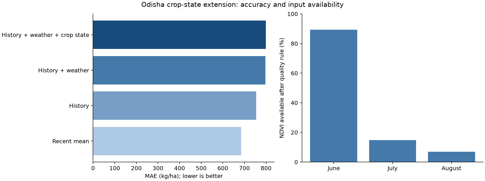

# Crop-state extension: completed comparison

Completed 22 October 2026. **Adding the exported vegetation and surface soil-moisture variables did not improve the fixed Random Forest in this experiment.** This is a measured negative finding, not evidence that such variables can never help rice-yield prediction.

## Files and linkage

The four downloaded v3 CSVs were placed under `data/processed/rice/crop_state/`. They were moved, without modifying their bytes, to the original-export folder `data/raw/rice/crop_state/`. The blocks contain 120, 120, 90 and 90 rows: 420 total, covering 30 Odisha district references and start years 2004–2017.

Import checked exact district/year keys, no duplicates, the Y−2 land-cover year, observation end August 24, export version, daily/composite counts, value ranges, spatial coverage and missing-value flags. The joined labels match the original official DES yield values exactly; all historical lags and the five-year reference were preserved. The join is one-to-one on Census-reference district code and agricultural start year. This validates the files and linkage, not independent pixel-level verification of the user's authenticated cloud computation. Fixed 2011 boundary equivalence and historical publication timing remain limitations.

## What the downloaded data provide

| Feature group | Available records after declared quality rules | Meaning |
| --- | ---: | --- |
| June NDVI | 375 / 420 (89.3%) | Cropland vegetation activity |
| July NDVI | 62 / 420 (14.8%) | Cropland vegetation activity |
| August NDVI | 29 / 420 (6.9%) | Latest composite completed by the cutoff, including late-July observations |
| Soil moisture, each of the three months | 420 / 420 | ERA5-Land modelled water fraction in surface soil, 0–7 cm |

The minimum soil spatial coverage is 71.6%. All expected soil image dates are present. The vegetation export is highly incomplete after the existing good-quality/25%-valid-area rules. Cloud/quality masking is a plausible constraint, but this table alone does not establish the precise cause of every missing value. No threshold was weakened, no difficult district-year was dropped, and no absent vegetation value was treated as a real zero.

The CSV's −9999 codes become missing values. Training-only median imputation and three missingness indicators allow the fixed experiment to retain all rows. Most July/August vegetation values supplied to the fitted model are therefore imputed, not observed. Mapped cropland includes other crops and cropland/natural mosaics; soil moisture is coarse model output, not measured field water, soil aluminium or rice-specific toxicity.

## Model comparison

The [fixed protocol](Crop_State_Comparison_Protocol.md) implements the previously declared four methods. All forests use 300 trees, depth 4, minimum leaf size 10 and seed 42. There is no new tuning or winner selection. Each evaluation year 2012–2017 uses outcomes only through Y−2 for fitting. Each method predicts the same 180 district-years, keeping all districts together by year.

| Method | MAE, kg/ha | RMSE, kg/ha | R squared |
| --- | ---: | ---: | ---: |
| Recent historical mean | 684.3 | 814.5 | −0.162 |
| History forest | 754.4 | 954.6 | −0.597 |
| History + weather forest | 796.6 | 1000.7 | −0.755 |
| History + weather + crop-state forest | 798.8 | 1002.6 | −0.761 |

Lower error is better. Crop-state augmentation increases MAE by 2.3 kg/ha relative to the same forest with history/weather. The six-year bootstrap interval for MAE reduction is −6.3 to +2.6 kg/ha, crossing zero. Against recent mean, the full forest increases MAE by 114.5 kg/ha; the exploratory reduction interval is −419.5 to +165.6. Six years and possible dependence make these intervals weak evidence; no statistically established augmentation benefit is claimed.

The full forest has particularly large errors in 2012 (1059.3 kg/ha) and 2014 (1729.3 kg/ha). Fitting errors are much smaller than forecast errors, illustrating that learning the historical sample does not ensure generalisation to these years. Sparse usable NDVI, mixed-crop/coarse predictors and temporal differences constrain interpretation; this comparison does not isolate their individual causal contributions.

These evaluation outcomes were already seen in prior work. This is an exploratory feature-block comparison, not a new independent validation. It does not establish reliable operational forecasting, damage alerts, protein/aluminium effects or financial savings. No existing dashboard method was replaced after looking at these results.

## Verification and reproducibility

Local checks confirm 720 unique saved forecasts across the four identical assessment cohorts; correct fitting cutoffs; inference without a target column; training-only imputation medians; and exact benchmark arithmetic. Completed reruns verify pinned inputs, code, environment and output hashes without fitting again. The original datasets, earlier studies and forecast artifacts remain unchanged.

Run `python app.py --compare-crop-state-models`. The module `src/rice_crop_state_model.py` is imported through the sole launcher `app.py`. Raw exports and joined-input receipts retain SHA256 hashes. Outputs are in `data/processed/rice/crop_state_model/`:

- `predictions.csv`, overall/year/district metrics and paired annual error changes.
- `fitting_diagnostics.csv` and `imputation_audit.csv`.
- `summary.json`, run manifest and completed checksum receipt.
- Three figures: accuracy/input availability; yearly errors; actual/predicted scatter and error pattern.

The acquisition guide retains its dated preparation/correction history. This results note and the README record the completed acquisition and modelling status.

Sources: NASA/USGS MOD13Q1.061 and MCD12Q1.061; Copernicus/ECMWF ERA5-Land daily aggregates through Google Earth Engine; official DES yield labels; DataMeet Census-2011-derived reference geometry (CC BY 2.5 India). Source definitions and literature are linked in the acquisition protocol.
