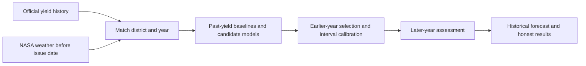

# Rice Yield Outlook — presentation guide

Birla Institute of Technology, Mesra
Department of Quantitative Economics and Data Science
Guide: Dr. Manish Kumar Pandey

## What to present

**Question:** Can weather observed before harvest improve district rice-yield predictions over recent-yield history?

**Main research study:** Kharif rice in 30 Odisha districts. We use real government yield records and NASA weather, compare methods on earlier years, and evaluate the preselected method on later years. The app also retains a separate five-state annual study so users can select Bihar, Chhattisgarh, Jharkhand, Odisha and West Bengal. Annual and Kharif forecasts are different studies and must not be presented as the same target or boundary system.

## A three-minute explanation

1. **Problem:** Rice yield varies between years. A pre-harvest estimate could support planning. This project tests a forecasting method; it does not demonstrate financial savings.
2. **Data:** Official DES Kharif rice records for Odisha, 1998–2022, supply yield in kg/ha after conversion from tonnes/ha. NASA POWER supplies daily weather. District polygons provide area weights. We have 600 development labels and 150 later-year assessment labels.
3. **Inputs:** Five past yields from Y−2 to Y−6, their mean and trend, year and district. Weather candidates also receive 19 summaries of rain, maximum/minimum temperature, humidity and solar energy through 24 August. Forecast issue date is 31 August. Target-year area and production check source consistency but never enter prediction.
4. **Methods:** Thirteen configurations: three simple baselines; six Ridge configurations; two Random Forest configurations; two histogram gradient-boosting configurations. Earlier-year validation chooses one configuration. Later-year assessment evaluates that frozen choice.
5. **Findings:** Development selected history-only Ridge, alpha 10. On 2018–2022, MAE is 517 kg/ha versus 578 for recent mean. Random Forest depth 4 reached 405 kg/ha, but this is a secondary result, not a replacement selected after seeing assessment. Weather's added value remains uncertain.
6. **Limits:** Approximate intervals are wide and low-yield flags are weak. Boundaries and reporting delays involve assumptions. This is a completed historical research prototype, not a proven operational forecasting service.

## Know these terms

| Term | Meaning |
| --- | --- |
| Yield | Harvested grain per unit area; kg/ha. Not acreage. |
| Predictor / X | An input available before the forecast, such as a past yield or early-season weather. |
| Target / Y | The harvest yield we want to estimate. |
| Baseline | A simple comparison, such as the average of five past yields. |
| Ridge | Linear regression with regularization to restrain unstable coefficients. |
| Random Forest | An average of many decision trees; can learn nonlinear patterns. |
| Histogram gradient boosting | Trees fitted sequentially to improve prediction residuals. It is not XGBoost in the current Odisha study. |
| MAE | Average absolute error. 517 kg/ha means average error magnitude, not 517 kg total and not an accuracy percentage. |
| RMSE | An error measure that gives larger mistakes more weight. |
| R squared | Comparison with a constant assessment-mean benchmark. Negative values indicate weak squared-error performance. |
| Uncertainty interval | A range around the estimate. Both its observed coverage and width matter. |
| Low yield | Below 80% of a district's five-past-yield reference. This is not a measured disease or aluminium-damage label. |
| Leakage | Letting future or harvest information influence an earlier forecast. |

## How evaluation works

- **Model selection:** expanding validation in 2009–2012; all transforms fit on training rows only.
- **Calibration:** rolling predictions in 2014–2016 estimate interval width.
- **Assessment:** 150 district-years in 2018–2022, opened after selection/calibration were frozen.
- **Time rule:** fit only through Y−2. During assessment, an earlier assessment label can enter later fitting after two years. This is sequential assessment, not a fixed-model untouched holdout.
- **Reporting caveat:** the two-year yield delay and seven-day weather buffer are assumptions; exact historical release vintages are not verified.

## The two geographic options

| App selection | Annual rice | Odisha Kharif rice |
| --- | --- | --- |
| States | Bihar, Chhattisgarh, Jharkhand, Odisha, West Bengal | Odisha |
| Districts | 50 historical units | 30 reference districts |
| Yield source | ICRISAT District Level Database | Government DES |
| Target | Annual rice, combining seasons | Kharif rice |
| Geography | Historical 1966-apportioned units | Fixed 2011 reference polygons, assumed comparable |
| Weather comparison | 12 monthly variables | 19 daily-derived summaries |
| Later-year assessment | 2012–2017 | 2018–2022 |
| Selected model | History Ridge | History Ridge alpha 10 |
| MAE | 450 kg/ha | 517 kg/ha |

The errors concern different records and targets. Do not compare them as a head-to-head contest.

## Protein and aluminium — the precise claim

They are not inputs to either district forecast. Aluminium toxicity motivates biological research because it can harm roots in acidic soil. Separate trial experiments explored measured genetic variants annotated with reference protein context; they did not establish a reliable added forecasting benefit. Verified district-year exposure/variety links were unavailable. Keep this as supporting research, not a claim that the district model uses protein structures.

## Demonstrating the app

1. Start `app.py`. Choose a state, coverage, district and year in the sidebar.
2. In **Forecast**, explain the vertical yield table, then reveal the recorded outcome.
3. In **Model results**, show Accuracy and Model comparison. Identify the development-selected configuration before discussing the secondary forest result.
4. In **Data & methods**, show the data summary and validation rules.

## Files you need to understand

| File | Purpose |
| --- | --- |
| `app.py` | Sole launcher. |
| `src/rice_dashboard.py` | The complete presentation interface. |
| `src/dashboard.css` | White, black and blue visual styling. |
| `src/rice_regional.py` | Annual preparation, modelling and inference. |
| `src/rice_seasonal_data.py` | Official DES source parsing and development audit. |
| `src/rice_geography.py` | District identities and reference geometry checks. |
| `src/rice_odisha_seasonal.py` | Daily weather and safe yield-history preparation. |
| `src/rice_odisha_model.py` | Declared candidate comparison, calibration and gated assessment. |
| `data/` | Preserved raw datasets, processed inputs, results and receipts. |
| `models/` | Preserved model artifacts; `rice_regional.joblib` serves annual inference. |

Read [the complete seasonal results](Rice_Odisha_Model_Results.md) for exact metrics. Original protocols and their timing amendment remain intact. Earlier exploratory documentation is under `research_notes/`; diagrams, papers and local mentor materials are retained. Earlier illustrations may describe the initial wheat/protein proposal and should not be presented as the implemented rice forecasting pipeline.

## Current pipeline

## What makes the project complete

The dataset integration, timed evaluation, model comparison, result documentation and working app are complete. Mixed findings are research findings. Operational deployment and additional biological predictors are future extensions, not prerequisites for this presentation.
