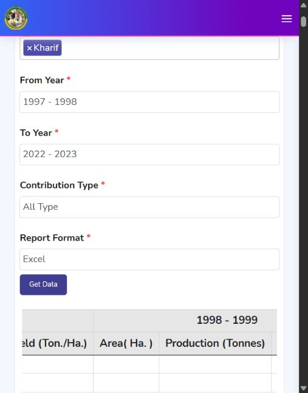

# Official Kharif rice source obtained

Downloaded and structurally checked 20 October 2026. This completes the official season-specific label acquisition requested after the [predictor audit](research_notes/Rice_Predictor_Linkage_Audit.md). It does not complete district-boundary verification or supply new matched weather/management observations. No model was fitted and no old forecast results were changed.

Subsequent step: the [district identity and dated reference-geometry review](Rice_Seasonal_Geography.md) now provides a crosswalk, documented split flags and a reference map, while keeping unresolved temporal equivalence explicit.

## Source and download

Publisher: Directorate of Economics and Statistics, Ministry of Agriculture and Farmers Welfare, Government of India. The [official APY query form](https://www.data.desagri.gov.in/website/apy-query-report-web) successfully loaded in the browser and exposed these selections:

- State: All States; District: All Districts.
- Crop: Rice; Season: Kharif.
- From agricultural year: 1997–1998; To agricultural year: 2022–2023.
- Contribution: All Type; Report Format: Excel.

The website displayed the table but did not save an Excel file in the browser. Its original public form code identifies a POST to `https://www.data.desagri.gov.in/report/crop/apy-query-report-show`, with Rice code 1 and Kharif code K. The website implements Excel export by passing the returned HTML table to `saveAsExcel`; the response is not a native XLSX workbook. We preserved that original report response as HTML rather than assigning it a misleading XLSX extension.

The successful request used Windows Invoke-WebRequest with its normal certificate validation. Python requests/certifi could not validate the issuer chain; certificate verification was not disabled. The decoded response was stored as UTF-8 without a BOM. Its receipt records the saved bytes and SHA-256, source URL and request fields. Public session tokens and cookies were not retained; the temporary query-page copy was removed. This route uses the same public request as the form, with no restricted-data bypass.

The report itself supplies state/district names and year/unit headers. Crop and season are established by the recorded official request rather than repeated in every report row. The [download receipt](../data/processed/rice/seasonal_source/download_manifest.json) records that distinction. No independent licence, historical publication date or boundary vintage was inferred.

## Verified structure and units

The national report contains **728 geographic rows** and **26 agricultural-year groups**, 1997–98 through 2022–23. These are report rows, not 728 verified stable longitudinal districts. Each year has three explicit headers:

| Source field | Official header unit | Prepared field |
| --- | --- | --- |
| Area | hectares | area_ha, retained |
| Production | tonnes | production_tonnes, retained |
| Yield | tonnes per hectare | source_yield_tonnes_ha, retained; yield_kg_ha = 1,000 x source yield |

This conversion is important: the official report yield is **not already kg/ha**. For development rows only, the audit also calculates 1,000 x production / positive area as a consistency diagnostic. The largest difference among positive complete triplets is **5.0 kg/ha**, consistent with rounded source yields; it is not used to replace the published target. Area/production values are target auditing fields, not same-season forecast predictors.

All expected year headers, unit groups and row widths pass the parser's explicit checks. State/district name pairs are unique within this snapshot. Unrecognized numeric formats cause a failure rather than a guessed conversion.

## Five-state development coverage

| State name in source | Geographic rows |
| --- | ---: |
| Bihar | 38 |
| Chhattisgarh | 33 |
| Jharkhand | 24 |
| Odisha | 30 |
| West Bengal | 22 |
| Total | 147 |

The 1997–2017 development grid has **3,087 district-name/year combinations**. Of these, **2,572 have positive complete area, production and yield triplets**. The remaining **515** are retained with flags, not silently assigned zero yield or used as valid targets. These counts describe reported values before geographic validation, not a final training cohort.

The positive-triplet flag is descriptive, not an exclusion rule for a future model. A reported zero yield with positive cultivated area could represent crop failure; it must not automatically be treated as missing or discarded. Resolve source zero/missing conventions before fixing the cohort, particularly for damage-risk studies.

See [development labels](../data/processed/rice/seasonal_source/development_labels.csv), [geographic inventory](../data/processed/rice/seasonal_source/district_inventory.csv) and [state/year coverage](../data/processed/rice/seasonal_source/state_year_coverage.csv). The table supplies 2017–18 as the final development agricultural year; the numeric start year is 2017.

## Reserved newer outcomes

Start years **2018–2022** remain in the original local report. Their area, production and yield cells are skipped before numeric conversion or summary generation and are absent from the prepared development labels. The coverage file records their header years and geographic row counts only; positive-target counts remain blank and explicitly labelled not inspected.

No newer values were displayed as examples, summarized, filtered, scored or used to choose model settings. Verification makes reserved-cell text access raise an exception and confirms that development preparation still succeeds. This protects the current preparation workflow; it is not an access-control system preventing somebody from manually opening the public raw report.

These years are **candidate** assessment years, not yet a frozen independent test. Before analysing their outcomes, verify whether the source republishes previously used observations, establish geography and the reporting-delay rule, and save the new study protocol. The old project trial, field and district assessments remain previously opened evidence.

## What still prevents training

1. **Geographic identity.** The source provides names, not official district IDs or boundary histories. Recently created district names appear as rows beside the full year header span; this does not establish historical comparability. Match official district creation/rename/split records and geographic units. Do not simply join this 147-name snapshot to the old 50 apportioned 1966 districts by name.
2. **Forecast-date alignment.** Verify regional Kharif crop calendars and publication timing. A proposed 31 August issue requires a pre-issue daily-data window and an availability buffer; monthly August values cannot automatically be treated as already published on that date.
3. **Matched weather.** Define validated district polygons or another justified spatial support before downloading crop-area-weighted daily weather. The old representative-point weather has four coordinate review flags and belongs to different historical geography.
4. **A new protocol.** Fix the eligible geography using metadata/development information, date rules, training and assessment years, historical baselines, Ridge, Random Forest and gradient boosting before opening the reserved outcomes. Do not change the existing annual model into Kharif by renaming its target.

So the next task is **district identity and boundary mapping**, followed by aligned daily weather. Additional arbitrary protein downloads are not required for that work. Soil, irrigation, fertilizer and crop-state inputs remain optional until they can be matched to these same units and dates.

## Local files and reproduction

The raw source is `data/raw/rice/des_kharif_2026/rice_kharif_1997_2022_report.html`. It remains local and ignored by Git, including reserved newer outcomes. Receipts, aggregate metadata and pre-2018 development labels are tracked in `data/processed/rice/seasonal_source/`. Do not claim the ignored raw report is included in a fresh clone.

From a project-root Python session using the project environment:

```python
from src.rice_seasonal_data import acquire_report, inspect_source
acquire_report()  # cached replay needs no network; a missing cache uses the public form
inspect_source() # validates headers and prepares development-only labels
```

Network acquisition uses normal TLS verification and may depend on client certificate stores or source availability. A manual export can use the exact form settings above. The importer expects the original named HTML report table, not arbitrary renamed CSV/XLSX files. It refuses a source checksum change against an existing receipt; preserve and version any new snapshot.

`app.py` remains the only application entry point. The dashboard's Data and research scope tab shows acquisition counts and metadata. It does not fit this new dataset or expose the reserved targets as forecast results.


